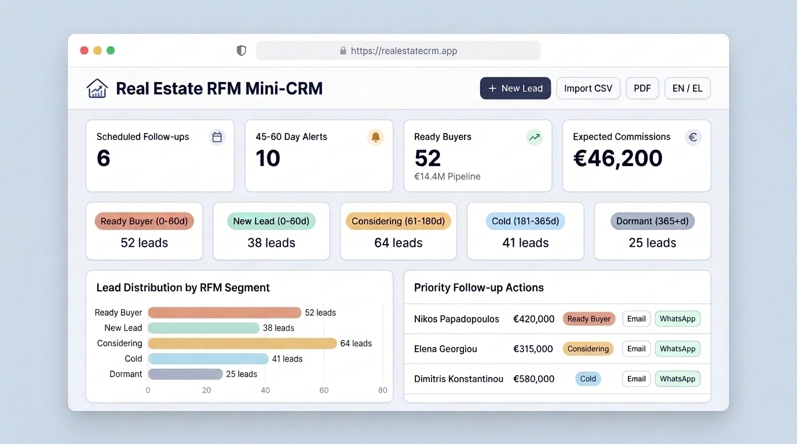
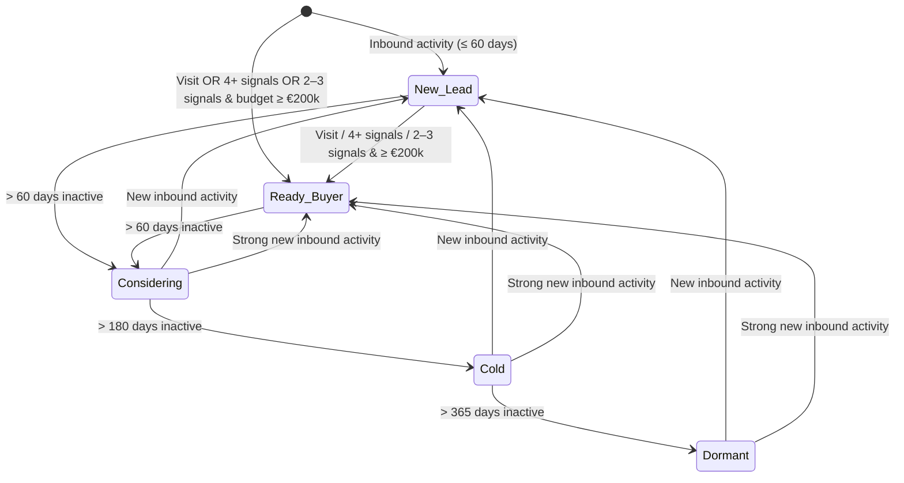

# 🏠 Real Estate RFM Lead Segmentation & Mini-CRM

[](https://karidasd.github.io/real-estate-rfm-segmentation/)
[](#)
[](#)

> **Adapting RFM (Recency, Frequency, Monetary) to a non-repeat industry like Real Estate** — bundled as a **100% client-side, installable PWA Mini-CRM** (English & Greek), complete with **SQL**, **Python**, and a **Jupyter Notebook**.

🌐 **Live Web App:** https://karidasd.github.io/real-estate-rfm-segmentation/  
📦 **Repository:** https://github.com/karidasd/real-estate-rfm-segmentation



---

## ✨ Key Application Features (100% Local / Zero Backend / GDPR-Safe)

1. **🎯 Daily Action Queue (`Today`):** Automatic **Priority Score (0–99)** surfacing overdue/today follow-ups, **45–60 day decay alerts**, VIP ready buyers, and leads one step away from upgrading — with 1-click **Email (`mailto:`)**, **WhatsApp**, and **Done** tracking (`localStorage`).
2. **📊 CRM Database, Kanban Pipeline Board & Tags:** Toggle between **Table** and **Kanban Board** views, tag leads (`VIP`, `Cash`, `Mortgage`, `Investor`, `Urgent Buyer`), log new inbound signals or property visits (auto-recomputing segments live), and export Excel-ready CSVs (UTF-8 BOM).
3. **🔗 Smart CSV Column Mapper:** Upload exports from *any* CRM (supports `,` and `;` delimiters, auto-calculates recency days from last-contact dates).
4. **🏠 Property-to-Buyer Matcher:** Enter a new listing's area and price (±10%/15%/25% tolerance) to instantly find matching buyers ranked from **Ready Buyers** down to **Considering**, with 1-click Email/WhatsApp & CSV export.
5. **💰 Agency Commission Forecast & What-If Threshold Lab:** Convert pipeline budget into **expected brokerage commissions (€)**, quantify **commissions at risk** from 45–60 day alerts, and run live sensitivity analysis on RFM thresholds (60d / €200k / 4+ signals).
6. **📅 Calendar Reminders (`.ics`), Dark Mode, JSON Backup/Restore, PDF Report & Bilingual UI (`EN / EL`):** Download standard `.ics` calendar invites for Google Calendar / Outlook, switch Light/Dark theme, toggle English/Greek, export an executive PDF report, or install as a **PWA**.

---

## 💡 How Classical RFM Maps to Real Estate

| RFM Dimension | Classical E-commerce | Real Estate Adaptation |
| :--- | :--- | :--- |
| **R — Recency** | Days since last purchase | Days since last **inbound** client action *(ignoring outbound follow-ups!)* |
| **F — Frequency** | Number of orders | Count of inbound signals/inquiries (`2–3`, `4+`) & **property visits** |
| **M — Monetary** | Total spend | Stated **budget** (`≥ €200,000` acts as an accelerator for Ready Buyers) |

> **Key Data Engineering Detail:** Only client-initiated interactions (`WHERE direction = 'inbound'`) reset Recency — preventing agency newsletters or follow-up calls from artificially keeping inactive leads "warm".

---

## 🔄 5-Segment Lifecycle State Machine



---

## 📂 Repository Structure

```text
real-estate-rfm-segmentation/
├── index.html                               # Full Bilingual (EN/EL) Mini-CRM PWA (GitHub Pages)
├── manifest.json & icon.svg                 # PWA installable app manifest & icon
├── data/
│   ├── sample_crm_leads.csv                 # 150 synthetic CRM leads
│   └── sample_interactions.csv              # 753 inbound/outbound interactions for SQL practice
├── sql/
│   └── rfm_segmentation.sql                 # Full segmentation logic in SQL (CTEs + CASE WHEN)
├── python/
│   ├── segment_leads.py                     # Zero-dependency Python script for KPIs & CSV exports
│   └── generate_sample_data.py              # Synthetic dataset generator
└── notebooks/
    └── rfm_analysis_walkthrough.ipynb       # Educational Jupyter Notebook (pandas + attribution)
```

---

## 🚀 Quick Start

* **Live App:** Open https://karidasd.github.io/real-estate-rfm-segmentation/ (click `🇬🇧 EN` / `🇬🇷 EL` in the top right to switch language).
* **Python Script (standard library only):**
  ```bash
  python python/segment_leads.py
  ```
* **SQL Practice:** Inspect [`sql/rfm_segmentation.sql`](sql/rfm_segmentation.sql) to see how `WHERE direction = 'inbound'`, `GROUP BY`, and `CASE WHEN` implement the exact same rules.

---

## 🇬🇷 Ελληνική Περίληψη (Greek Overview)

Εκπαιδευτικό **Data Analyst Case Study** και πλήρης **Mini-CRM εφαρμογή** για το Real Estate που μεταφράζει τη λογική **RFM** σε 5 δυναμικά segments (**🔥 Έτοιμος αγοραστής**, **🌱 Νέος ενδιαφερόμενος**, **⌛ Σε σκέψη**, **❄️ Σε ψύξη**, **🌙 Σε νάρκη**) βάσει αποκλειστικά των **εισερχόμενων** επικοινωνιών του πελάτη, των επισκέψεων και του budget (`≥ 200.000€`).

Περιλαμβάνει:
* **Ημερήσια Λίστα Προτεραιότητας** με Priority Score, Alerts 45–60 ημερών, 1-κλικ Email/WhatsApp & Calendar reminders (`.ics`).
* **Kanban Board**, **Tags**, **Smart CSV Column Mapper** (για οποιοδήποτε CRM), **Matcher Νέου Ακινήτου**, **Πρόβλεψη Προμηθειών (€)** & **What-If Lab**.
* **SQL**, **Python** & **Jupyter Notebook** για πλήρη κατανόηση της ανάλυσης δεδομένων.
