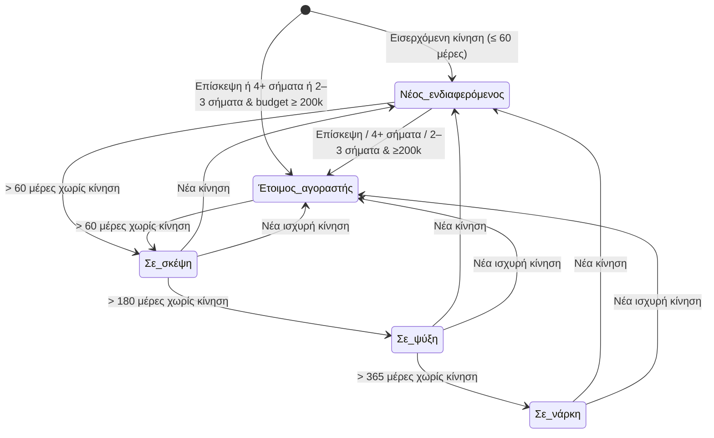

# 🏠 Real Estate RFM Lead Segmentation

> **Data Analyst Case Study:** Πώς προσαρμόζουμε τη λογική **RFM (Recency, Frequency, Monetary)** σε έναν κλάδο *χωρίς επαναλαμβανόμενες αγορές* όπως το **Real Estate**, μετατρέποντάς την σε ένα πρακτικό σύστημα 5 segments για στοχευμένα email campaigns.

🌐 **Live Web App (GitHub Pages):** https://karidasd.github.io/real-estate-rfm-segmentation/  
📦 **Repository:** https://github.com/karidasd/real-estate-rfm-segmentation

---

## 💡 Η Επιχειρηματική Ιδέα

Στο κλασικό e-commerce το RFM βασίζεται σε συχνές αγορές. Στα ακίνητα, όμως, ένας πελάτης αγοράζει σπάνια. Η λύση είναι να αντικαταστήσουμε τις αγορές με **σήματα πρόθεσης αγοράς (intent signals)**:

| Διάσταση RFM | Κλασικό E-commerce | Προσαρμογή στο Real Estate |
| :--- | :--- | :--- |
| **R — Recency** | Ημέρες από την τελευταία αγορά | Ημέρες από την τελευταία **εισερχόμενη** κίνηση πελάτη *(αγνοούμε τα δικά μας follow-ups!)* |
| **F — Frequency** | Πλήθος παραγγελιών | Αριθμός σημάτων/αιτημάτων (`2–3`, `4+`) & **επίσκεψη σε ακίνητο** |
| **M — Monetary** | Συνολική δαπάνη | Δηλωμένο **budget** (από `200.000€+` λειτουργεί ως επιταχυντής) |

> **Κρίσιμη λεπτομέρεια Data Engineering:** Μετράμε **μόνο** τις επικοινωνίες που ξεκινάει ο πελάτης (`direction = 'inbound'`), ώστε τα δικά μας follow-ups ή newsletters να μην «αλλοιώνουν» το Recency και κρατούν τεχνητά ζεστούς ανενεργούς πελάτες.

---

## 🔄 Κύκλος Ζωής των 5 Segments (Lifecycle State Machine)



---

## ✉️ Email Campaign Playbook & KPIs

| Segment | Χρονικό Παράθυρο | Προτεινόμενη Ενέργεια / Email | Κύριο KPI |
| :--- | :--- | :--- | :--- |
| 🔥 **Έτοιμος αγοραστής** | έως 60 μέρες | Προσωπική επαφή, 2–3 στοχευμένα ακίνητα στο budget, πρόταση για υπόδειξη | Visit-to-Offer & Conversion Rate |
| 🌱 **Νέος ενδιαφερόμενος** | έως 60 μέρες | Welcome email, συλλογή κριτηρίων (περιοχή/budget), επιλεγμένες προτάσεις | Qualification Rate (άνοδος σε «Έτοιμο») |
| ⌛ **Σε σκέψη** | 61–180 μέρες | Nurturing: νέα ακίνητα στην περιοχή, ενημερώσεις τιμών / price drops | Click-Through & Reactivation Rate |
| ❄️ **Σε ψύξη** | 181–365 μέρες | Re-engagement («Ψάχνετε ακόμα στην περιοχή Χ;») με 1-click επιλογές | Reactivation Rate |
| 🌙 **Σε νάρκη** | 365+ μέρες | Τριμηνιαίο market report ή καθαρισμός λίστας (list hygiene) | Unsubscribe / Deliverability Health |

> 💡 **Bonus Προσθήκη — Alert 45–60 ημερών:** Εντοπίζει αυτόματα τους «Έτοιμους αγοραστές» που πλησιάζουν τις 60 μέρες αδράνειας, ώστε η ομάδα να κάνει στοχευμένο follow-up *πριν* υποβαθμιστούν σε «Σε σκέψη».

---

## 📂 Δομή του Repository

```text
real-estate-rfm-segmentation/
├── index.html                    # Διαδραστικό Web App (Simulator + Local CSV Analyzer & Exporter)
├── data/
│   ├── sample_crm_leads.csv      # 150 συνθετικοί (εικονικοί) πελάτες CRM
│   └── sample_interactions.csv   # 753 inbound/outbound επικοινωνίες για SQL εξάσκηση
├── sql/
│   └── rfm_segmentation.sql      # Η πλήρης λογική σε SQL (WHERE direction = 'inbound' + CASE WHEN)
└── python/
    ├── segment_leads.py          # Python script για KPIs & export λιστών ανά segment (UTF-8 BOM)
    └── generate_sample_data.py   # Generator του συνθετικού dataset
```

---

## 🚀 Πώς να το χρησιμοποιήσεις

### 1. Live Web Εργαλείο (GitHub Pages)
* Άνοιξε το `index.html` απευθείας στον browser σου ή ενεργοποίησε το **GitHub Pages** (`Settings → Pages → Branch: main / root`).
* Δοκίμασε το **Segment Simulator** ή ανέβασε το δικό σου CSV στο **CRM CSV Analyzer** (100% τοπική επεξεργασία στον browser — κανένα δεδομένο δεν αποστέλλεται σε server).

### 2. Εκτέλεση του Python Script
Δεν απαιτεί εξωτερικές βιβλιοθήκες (τρέχει με standard Python 3):
```bash
python python/segment_leads.py
```
Δημιουργεί τον φάκελο `output/` με ξεχωριστό `.csv` για κάθε segment, έτοιμο για import σε εργαλεία email marketing.

### 3. Εξάσκηση σε SQL
Άνοιξε το [`sql/rfm_segmentation.sql`](sql/rfm_segmentation.sql) για να δεις πώς εφαρμόζεται η λογική με `WITH` (CTEs), `WHERE direction = 'inbound'`, `GROUP BY` και `CASE WHEN`.

---

## 🧭 Προτεινόμενα Επόμενα Βήματα (Validation)
1. **Έλεγχος των ορίων (Thresholds):** Μετά από 2–3 μήνες καμπανιών, έλεγξε το conversion rate ανά segment για να επιβεβαιώσεις με πραγματικά δεδομένα αν οι **60 μέρες** και οι **200.000€** είναι τα ιδανικά όρια.
2. **Διάκριση Αγοραστών vs Ενοικιαστών:** Αν το CRM περιέχει και ενοικιάσεις, φρόντισε ο κανόνας του budget (`≥ 200.000€`) να εφαρμόζεται μόνο σε πελάτες αγοράς.
